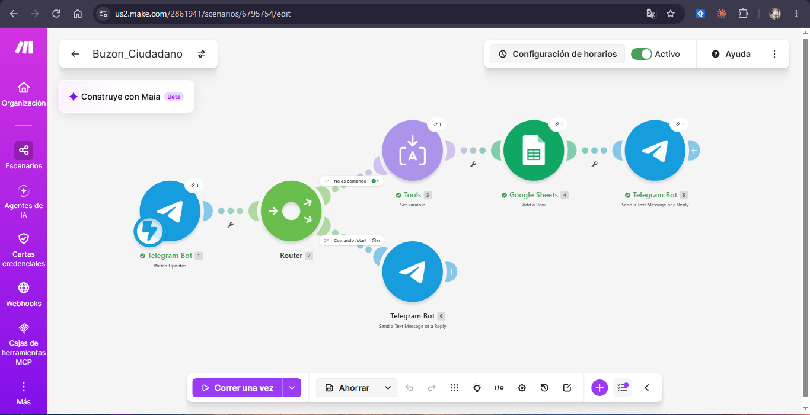
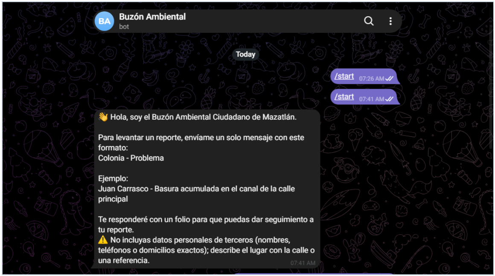
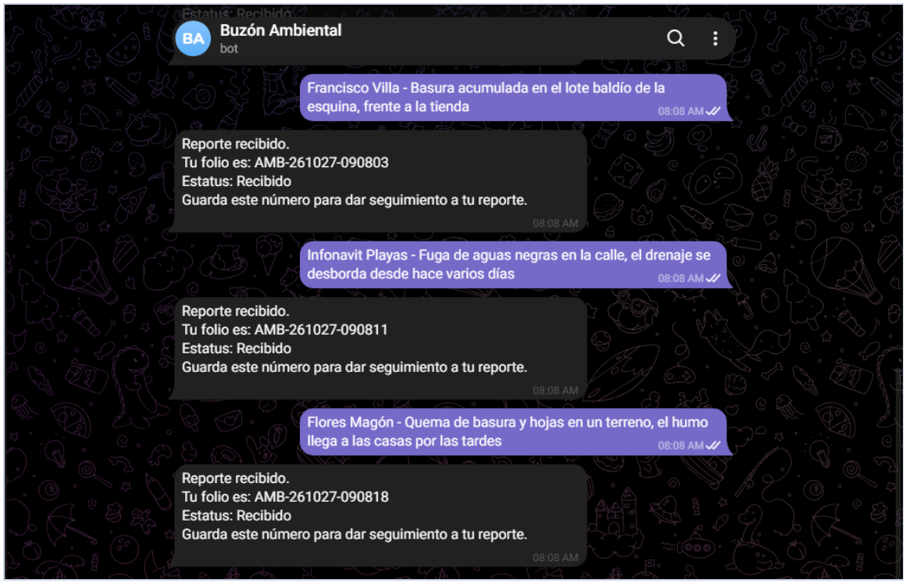

# Práctica 3.1 — Buzón ciudadano con folio

**Materia:** Desarrollo Sustentable (ACD-0908) · **Unidad 3:** Escenario socio-cultural · **Tema:** 3.1 Sociedad, organización social
**Autor:** Roberto Carlos Robles Campos · **Institución:** Instituto Tecnológico de Mazatlán
**Herramientas:** Telegram (BotFather), Make, Google Sheets

El reporte completo en PDF (con portada, fuentes y capturas de la hoja de registro) está en [`resultados/Resultados.pdf`](resultados/Resultados.pdf).

## 1. Descripción

Buzón ciudadano automatizado, construido sin programar, que recibe reportes
ambientales por Telegram, los registra en una hoja de Google Sheets con fecha,
usuario y **folio**, y responde al ciudadano con ese folio, como lo haría una
ventanilla oficial.

## 2. Objetivo

Identificar qué organizaciones de Mazatlán atienden los problemas ambientales y
construir un buzón ciudadano automatizado que registre reportes con fecha,
usuario y folio, para reflexionar sobre el valor de la participación ciudadana
formal.

## 3. Arquitectura del escenario



```
Telegram Bot: Watch Updates
        │
     Router
   ┌────┴──────────────────────────┐
   │ Filtro "No es comando"        │ Filtro "Comando /start"
   │ (texto existe y no empieza    │ (texto = "/start")
   │  con "/")                     │
   ▼                               ▼
Tools: Set variable (folio)   Telegram: Send a Text Message
   ▼                          (instrucciones de uso)
Google Sheets: Add a Row
   ▼
Telegram: Send a Text Message (folio)
```

| Módulo | Configuración |
|---|---|
| Telegram Bot → Watch Updates | Conexión con el token del bot (guardado solo en Make) y webhook vinculado con `setWebhook` |
| Tools → Set variable | `folio` = `AMB-{{formatDate(now; "YYMMDD-HHmmss")}}` |
| Google Sheets → Add a Row | Folio = `folio` · Fecha = `{{formatDate(now; "DD/MM/YYYY HH:mm")}}` · Usuario = Message → From → Username · Nombre = Message → From → First name · Reporte = Message → Text · Estatus = `Recibido` |
| Telegram → Send a Text Message | Chat ID = Message → Chat → ID · Texto: *Reporte recibido. Tu folio es: {{folio}} · Estatus: Recibido · Guarda este número para dar seguimiento a tu reporte.* |

La zona horaria del perfil de Make es `America/Mazatlan`, para que la fecha y el
folio salgan con la hora local. La hoja se llama `Buzon_Ciudadano_RobertoRobles`,
con la pestaña `Reportes` y los encabezados **Folio, Fecha, Usuario, Nombre,
Reporte, Estatus**.

### Filtros del Router

| Ruta | Filtro | Condición |
|---|---|---|
| 1 (registro) | No es comando | `{{1.message.text}}` existe **y** no empieza con `/` |
| 2 (ayuda) | Comando /start | `{{1.message.text}}` es igual a `/start` |

El primer filtro evita registrar comandos, fotos o stickers sin texto; el
segundo hace que `/start` responda con las instrucciones de uso en lugar de
registrarse como un reporte.

El blueprint está en [`codigo/blueprint.json`](codigo/blueprint.json). El ID de
la hoja de Google se reemplazó por `TU_SPREADSHEET_ID`: al importarlo hay que
elegir tu propia hoja.

## 4. Investigación: ¿quién atiende los problemas ambientales en Mazatlán?

| Organización | Tipo | Qué problemas atiende | Cómo se reporta | ¿Entrega folio? |
|---|---|---|---|---|
| **PROFEPA** | Federal | Daños ambientales de competencia federal: descargas a cuerpos de agua nacionales, zona federal marítimo-terrestre, flora y fauna silvestre, residuos peligrosos, industria | En línea (formulario en gob.mx), correo, teléfono 800 PROFEPA (7763372, se ratifica en 3 días hábiles), oficina en Sinaloa y app Mi Profepa | Sí: se registra con número de expediente y se da seguimiento |
| **SEBIDES** | Estatal | Contaminación del aire, ruido excesivo, humo, malos olores, tiraderos de basura, quema de soca, tala ilegal | Buzón físico en el Palacio de Gobierno (Culiacán), teléfono, correo; admite denuncia anónima | No lo indica la fuente |
| **Dirección de Ecología y Medio Ambiente** (Ayuntamiento) | Municipal | Quejas por incumplimiento de reglamentos ambientales municipales: basura, quemas, ruido, maltrato animal, manglares | Portal Ecosistema Digital, App Mazatlán (categoría Ecología), teléfono, correo, oficina en el Centro | Parcial: el portal da seguimiento a los reportes registrados |
| **JUMAPAM** | Municipal (descentralizado) | Fugas de agua potable, derrames de aguas residuales, drenaje tapado, descargas de negocios sin trampa de grasa | Línea Aquatel 073 y redes sociales oficiales | No lo indica la fuente |
| **CEMDA** | Social (organización civil) | Asesoría y defensa legal ambiental a comunidades, pueblos indígenas y sociedad civil frente a proyectos que dañan ecosistemas | Contacto en su sitio web (oficinas regionales) | No: brinda acompañamiento legal, no recibe reportes con folio |

Fuentes al final de este documento.

## 5. Pruebas con reportes reales

Envié tres reportes con el formato *Colonia - Problema*, sin datos personales de
terceros, y otros usuarios también enviaron reportes al buzón. Cada reporte se
registró con su folio, fecha y usuario, y el bot respondió con el folio.

| Folio | Reporte (Colonia - Problema) | Organización que debe atenderlo |
|---|---|---|
| AMB-261027-090803 | Francisco Villa - Basura acumulada en el lote baldío de la esquina, frente a la tienda | Dirección de Ecología y Medio Ambiente (Ayuntamiento) |
| AMB-261027-090811 | Infonavit Playas - Fuga de aguas negras en la calle, el drenaje se desborda desde hace varios días | JUMAPAM (Aquatel 073) |
| AMB-261027-090818 | Flores Magón - Quema de basura y hojas en un terreno, el humo llega a las casas por las tardes | Dirección de Ecología municipal o SEBIDES |
| AMB-261027-090346 | Villa Florida - Poste de luz en el piso *(otro usuario)* | Ayuntamiento (alumbrado público) o CFE |
| AMB-261027-090826 | Reporte que la jumapan reparó una tubería de agua en la avenida Acapulco *(otro usuario)* | JUMAPAM |

El comando `/start` responde con las instrucciones de uso y no se registra en la hoja:



Mis tres reportes y la respuesta automática con el folio de cada uno:



La captura de la hoja `Reportes` con los registros está en el
[reporte en PDF](resultados/Resultados.pdf) (Figura 3).

### Video de la prueba en vivo

[Ver la prueba en YouTube](https://youtu.be/8ivm59bkCHI) — "Práctica Buzón
Ciudadano": el escenario en Make, el comando `/start`, el envío de un reporte con
su folio y el registro en la hoja.

Enlace también en [`video/enlace.txt`](video/enlace.txt).

## 6. Comparación con un sistema oficial (PROFEPA)

| Aspecto | Denuncia popular ante PROFEPA | Mi buzón ciudadano |
|---|---|---|
| Datos que pide | Nombre, domicilio y teléfono del denunciante; descripción de los hechos; datos para identificar al presunto infractor o la fuente contaminante; pruebas | Solo el texto del reporte. Usuario y nombre se toman de Telegram; no pide ubicación exacta ni evidencia |
| Verificación | Verifica teléfono y domicilio; si no coinciden, la denuncia es improcedente | No verifica identidad; cualquiera con Telegram puede reportar |
| Folio | Registra la denuncia con número de expediente | Folio automático e inmediato (`AMB-AAMMDD-HHmmss`) |
| Seguimiento | Admite la denuncia si es de competencia federal o la canaliza a la autoridad competente | El estatus se queda en "Recibido"; nadie lo actualiza y el ciudadano no puede consultar su folio |
| Canales | En línea, correo, teléfono, oficina y app | Solo Telegram |
| Respaldo legal | Denuncia popular prevista en la LGEEPA; obliga a la autoridad a atenderla | Ninguno: es un registro, no un trámite oficial |

**Qué le falta al bot para ser un canal formal:**

- Una **autoridad responsable** que reciba los reportes, los clasifique y los canalice a la dependencia competente.
- **Plazos de respuesta** definidos y **actualización del estatus** (Recibido → En revisión → Atendido), con aviso al ciudadano.
- Un comando para **consultar el estatus con el folio**.
- Pedir **ubicación y evidencia** (foto o referencia del lugar) y, cuando la autoridad lo requiera, datos de contacto verificables.
- Un **aviso de privacidad** y manejo responsable de los datos personales.

**Mejora implementada:** se agregó un Router para que, cuando el usuario envía
`/start`, el bot responda con las instrucciones de uso (formato *Colonia -
Problema*, un ejemplo y el aviso de no incluir datos de terceros) en lugar de
registrar el mensaje.

## 7. Preguntas de reflexión

**1. ¿Por qué es importante que un reporte ciudadano reciba un folio? ¿Qué pasa con los reportes que se hacen solo de palabra o en redes sociales?**
El folio es la prueba de que el reporte existe y de cuándo se hizo. Con él, el
ciudadano puede preguntar por su caso, exigir una respuesta y demostrar que la
autoridad ya fue avisada; también permite contar cuántos reportes hay de un
mismo problema. Los reportes hechos de palabra o en redes sociales no quedan
registrados: no hay quién se haga responsable de ellos, no se pueden rastrear y
es fácil que se pierdan o se ignoren, aunque generen visibilidad momentánea.

**2. De las organizaciones investigadas, ¿cuál les pareció más accesible para un ciudadano y cuál menos? ¿Por qué?**
La más accesible es JUMAPAM: basta llamar al 073 para reportar una fuga o un
drenaje tapado, y es un problema que se ve todos los días en las colonias.
También la Dirección de Ecología municipal, porque permite reportar desde el
celular con la App Mazatlán. La menos accesible para un ciudadano común es
PROFEPA: tiene el proceso más formal, pide datos personales verificables y
pruebas, solo atiende asuntos de competencia federal, y si se denuncia por
teléfono hay que ratificar en tres días. SEBIDES también es poco accesible desde
Mazatlán, porque su buzón físico está en Culiacán.

**3. ¿Qué problemas ambientales se repitieron más en los reportes? ¿Qué organización debería atender cada uno?**
En mis reportes aparecieron basura acumulada en un lote baldío, una fuga de
aguas negras y quema de basura; los reportes de otros usuarios fueron un poste
de luz caído y un aviso de que JUMAPAM reparó una tubería de agua en la avenida
Acapulco. El tema que más se repitió fue **agua y drenaje**, que corresponde a
JUMAPAM. La basura en lotes y calles la atiende la Dirección de Ecología y Medio
Ambiente del municipio; la quema de basura, Ecología municipal o SEBIDES; el
poste caído, el Ayuntamiento (alumbrado público) o la CFE. Si un problema dañara
el estero, el mar, manglares o fauna protegida, correspondería a PROFEPA.

**4. ¿Quién puede quedar fuera de un buzón digital? ¿Cómo afecta eso a la equidad en la participación ciudadana?**
Quedan fuera las personas mayores o quienes no usan Telegram ni teléfonos
inteligentes, quienes no tienen internet o datos móviles (sobre todo en zonas
rurales o colonias marginadas), las personas con discapacidad visual si el bot
no es accesible, quienes no saben leer o escribir y quienes hablan una lengua
indígena o un idioma distinto al español. Si el único canal es digital, solo
participan quienes tienen acceso a la tecnología, y los problemas de los grupos
excluidos, que muchas veces son los más afectados, quedan sin registrar. Por eso
un buzón digital debe complementar, y no sustituir, los canales presenciales y
telefónicos.

**5. ¿Qué tendría que pasar para que su buzón fuera un canal formal y no solo un registro?**
Tendría que estar respaldado por una autoridad, por ejemplo la Dirección de
Ecología de Mazatlán o un convenio con ella, que reciba cada reporte, lo
clasifique y lo canalice a la dependencia competente (JUMAPAM, SEBIDES o
PROFEPA). Una persona responsable debería responder y actualizar el estatus en
un plazo definido, por ejemplo acuse en 24 horas y respuesta en 10 días hábiles,
y el ciudadano debería poder consultar su folio. Además se necesitaría un
fundamento en el reglamento municipal y un aviso de privacidad.

## 8. Conclusión

La práctica mostró que la participación ciudadana formal depende de que el
reporte quede registrado y pueda rastrearse. Con Telegram, Make y Google Sheets
se construyó, sin programar, un buzón que asigna folio y guarda cada reporte con
fecha y usuario. La comparación con PROFEPA dejó claro que el folio por sí solo
no basta: para que un canal sea formal se necesita una autoridad que responda en
un plazo y un seguimiento visible para el ciudadano. También es necesario cuidar
que los canales digitales no excluyan a quienes no tienen acceso a ellos.

## 9. Fuentes

1. PROFEPA. *Denuncia ante la Profepa.* https://www.gob.mx/profepa/articulos/denuncia-ante-la-profepa?state=published
2. PROFEPA. *¿Cómo puedes denunciar?* https://www.profepa.gob.mx/innovaportal/v/4991/1/mx.wap/31_como_puedes_denunciar.html
3. Gobierno del Estado de Sinaloa. *Quema de soca será sancionado en Sinaloa: SEBIDES.* https://sinaloa.gob.mx/quema-de-soca-sera-sancionado-en-sinaloa-sebides/
4. Luz Noticias (2 de abril de 2026). *SEBIDES llama a denunciar a quien contamine el medio ambiente.* https://www.luznoticias.mx/2026-04-02/sinaloa/sebides-llama-a-denunciar-a-quien-contamine-el-medio-ambiente-/284021
5. H. Ayuntamiento de Mazatlán. *Ecosistema Digital.* https://tics.mazatlan.gob.mx/ecosistema-digital/
6. H. Ayuntamiento de Mazatlán. *Manual de la Dirección de Ecología y Medio Ambiente.* https://transparencia.mazatlan.gob.mx/descarga/Marco%20Regulatorio/Municipio/Manuales/Ecologia%20y%20medio%20ambiente/Manual%20de%20Ecolog%C3%ADa%20y%20Medio%20Ambiente.pdf
7. H. Ayuntamiento de Mazatlán. *Lleva Ecología pláticas de concientización ambiental a planteles educativos.* https://www.mazatlan.gob.mx/lleva-ecologia-platicas-de-concientizacion-ambiental-a-planteles-educativos/
8. JUMAPAM. *Durante octubre, JUMAPAM realiza 1,958 acciones de mantenimiento a la infraestructura.* https://jumapam.gob.mx/blog/index.php/?articulo=jmp369_031125&alias_cat=prensa
9. JUMAPAM. *Atiende JUMAPAM reporte de fuga de agua residual en la Montuosa.* https://jumapam.gob.mx/blog/index.php/?articulo=atiende_jumapam_reporte_de_fuga_de_agua_residual_en_la_montuosa
10. Centro Mexicano de Derecho Ambiental (CEMDA). https://www.cemda.org.mx/
11. ESCR-Net. *Centro Mexicano de Derecho Ambiental (CEMDA).* https://www.escr-net.org/member/centro-mexicano-derecho-ambiental-cemda
